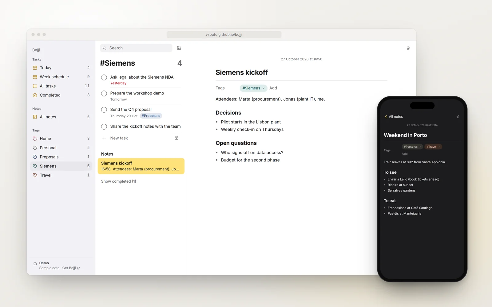
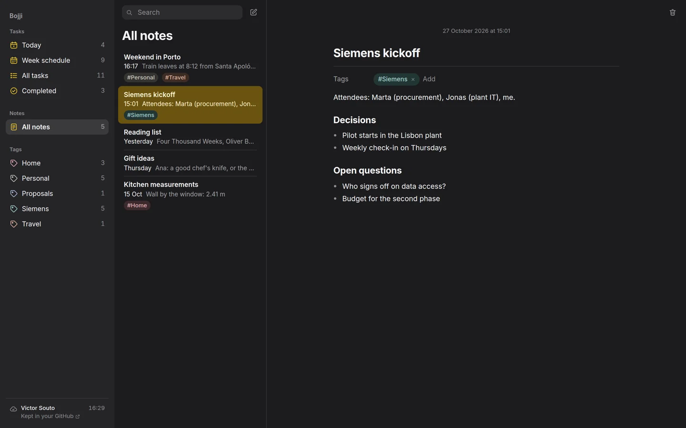
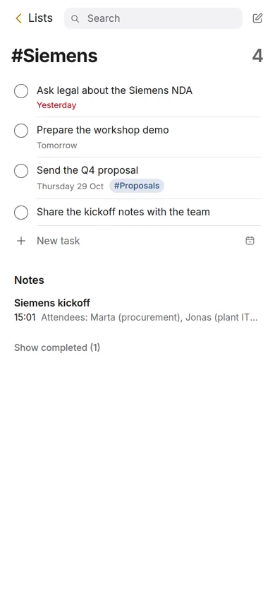

# Bojji

Free, open-source notes and tasks that live in **your own GitHub account**.

No subscription and no Bojji servers holding your data. Each note and task is a plain Markdown file in a private repository you own, so you get full version history and can read everything without Bojji.

**[Try the demo](https://vsouto.github.io/bojji/)**: it runs on sample data and saves nothing.



## What it does

- **Tasks** with due dates and optional times, in Today, Week schedule (Monday to Sunday, including the days that already passed), All tasks and Completed.
- **Add to Google Calendar** on any dated task: opens a pre-filled event (all-day, or one hour at the task's time). One way, no Google sign-in.
- **Notes** in Markdown. Headings and lists render in place, and the file stays plain text.
- **Tags** on tasks and notes, each with its own colour. Click a tag to see everything with it: open tasks, notes, then completed tasks.
- **Your own order.** Drag tasks within a day and notes within the list (long press on a phone, Alt+↑/↓ on a keyboard). Notes sort by date edited or manually; a move rewrites only that item's file.
- **Sync you can see.** Every change settles to "Kept in your GitHub", which links to your storage. If another device changed the same item first, Bojji reloads instead of overwriting.
- Light and dark mode, and a one-pane layout at phone width.

<p>
  
  
</p>

## How your data is stored

Your notes and tasks go in a separate private repository in your account, `bojji-data` by default, never in this code repository. Each item is one file:

```
tasks/mvr340e4-d88hk7.md
---
id: mvr340e4-d88hk7
type: task
title: Send the Q4 proposal
status: todo
due: 2026-10-29
time: 14:30
tags: Siemens, Proposals
order: a1V
updated: 2026-10-27T19:40:12.000Z
---
Optional notes in Markdown.
```

`due` and `time` are optional; `time` only appears with a date. `order` appears once an item has been placed by hand. Bojji talks to the GitHub API directly from your browser, and every save is a commit.

## Sign in

Open Bojji and choose **Sign in with GitHub**. The first time, Bojji walks you through two steps on GitHub: create a private `bojji-data` repository, then let the Bojji GitHub App use only that repository. Bojji can't see anything else in your account, and you can remove its access any time in your GitHub settings.

## Run it locally

Requires Node 22+ and the [GitHub CLI](https://cli.github.com/), logged in (`gh auth login`).

```bash
npm start      # open http://localhost:5173 and choose "Continue as <you>"
npm run smoke  # end-to-end test against GitHub (uses bojji-dryrun-data, cleans up after itself)
npm run test:worker   # the sign-in Worker against a fake GitHub
npm run test:calendar # calendar links and task times, offline
npm run test:order    # manual order keys and sorting, offline
```

Locally, the welcome screen also offers **Continue as <you>**, which uses your GitHub CLI login and creates `bojji-data` if it's missing. Set `BOJJI_REPO=<name>` to use another repository. To host your own copy with real sign-in, see [worker/README.md](worker/README.md).

## Roadmap

- Offline edits that sync later
- Dragging a task to another day
- Renaming and merging tags
- Native iOS and Android apps

## License

[MIT](LICENSE)
